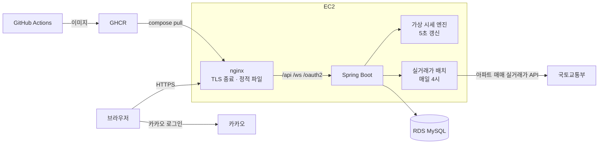

# 꿈이: 인생역전 VS 인생여전

가짜 시드머니로 가상 종목에 투자하고, 번 돈으로 국토교통부 실거래가 아파트를 사 보는 시뮬레이션 웹게임

- 서비스: https://kkumi.duckdns.org (카카오 로그인)
- 다 가짜라 잃을 게 없는 게임. 결과 화면을 캡처해 자랑하거나 놀리는 재미가 목표

## 스크린샷

<!-- 캡처 이미지 추가 예정 (docs/images/) -->

## 게임 규칙

| 단계 | 내용 |
| --- | --- |
| 1. 시작 | 카카오 로그인 → 시드머니 선택(500만 / 5,000만) |
| 2. 투자 | 서버가 만드는 가상 종목 20개를 현금으로 매수·매도. 평가액·손익 실시간 갱신 |
| 3. 집 찾기 | 집값의 40%는 내 돈, 60%는 가짜 대출. 평가액(현금 + 주식)이 집값 × 40% 이상이면 살 수 있는 집으로 추천 |
| 4. 집 사기 | 계약서에 도장 → 현금에서 40% 차감 (현금이 모자라면 주식을 직접 팔아서 마련) |
| 5. 내 마을 | 산 집 도감 + 보유 집 수에 따른 변신 4단계: 걸뱅이(0채) → 서민(1채) → 졸부(2~4채) → 갑부(5채 이상) |

- 순자산 = 평가액 + 내 집 지분(산 집 구매가 × 40% 합). 홈 카드·차트는 순자산, 집 추천은 평가액 기준 ([054](docs/decisions/054-net-worth-house-equity.md))

## 기술 스택

| 영역 | 사용 |
| --- | --- |
| Backend | Java 21, Spring Boot 4.1, Spring Data JPA, Spring Security(OAuth2 Client), WebSocket(STOMP) |
| Frontend | React 19, TypeScript, Vite, TanStack Query, @stomp/stompjs |
| DB | MySQL(AWS RDS), 테스트는 H2(MySQL 모드) |
| Infra | Docker Compose, nginx, AWS EC2, GitHub Actions, GHCR, Let's Encrypt |
| 규칙 검사 | ArchUnit, ESLint 레이어 규칙, Git 훅(pre-commit, commit-msg) |

## 아키텍처



- 요청 흐름: nginx가 React 빌드 결과를 서빙하고 `/api`, `/ws`, 로그인 주소만 Spring Boot로 전달
- 인증: 카카오 로그인 성공 → 서버가 JWT를 HttpOnly 쿠키로 발급 → 쿠키 필터가 요청마다 인증
- 실시간: STOMP WebSocket으로 접속자별 평가액을 5초마다 개인 큐(`/user/queue/portfolio`)에 푸시
- 배포: main merge → 이미지 빌드·GHCR push → EC2에 ssh로 `docker compose pull && up -d`

## 핵심 설계와 트레이드오프

결정마다 배경·대안·결과를 ADR로 남김 (`docs/decisions/`, 57개)

### 가상 시세 엔진
- 증권사 Open API, 공공데이터 시세 모두 서비스 제공(재배포)이 약관상 불가 → 서버가 직접 시세 생성 ([020](docs/decisions/020-stock-price-source.md), [failures/001](docs/failures/001-kis-stock-price-api.md))
- 랜덤 워크(시장 공통 + 종목 고유) + 평균 회귀(반감기 0.5일) + 한방형 급등락. 변동 배율은 가상 플레이어 시뮬레이션으로 결정 ([029](docs/decisions/029-virtual-price-movement.md))
- 현재가는 메모리, 1분마다 DB 저장 + 종료 직전 저장으로 재시작 후 복구 ([040](docs/decisions/040-virtual-price-snapshot.md))

### 매수·매도 동시성
- 같은 회원의 동시 매수로 잔액 검사를 둘 다 통과하는 문제 → 회원 행 비관적 락(`SELECT ... FOR UPDATE`)
- 낙관적 락(충돌 시 재시도 처리), Redis 분산 락(새 인프라)과 비교. EC2 1대 + RDS 1개라 DB 락으로 충분 ([025](docs/decisions/025-buy-concurrency-pessimistic-lock.md))
- 금액은 원 단위 `long` + `Math.multiplyExact`, 평균 매입가만 `BigDecimal` ([019](docs/decisions/019-money-type-long.md))

### 실시간 평가액
- 5초 폴링 → WebSocket 푸시. 평가액은 사람마다 달라서 공용 방송이 아니라 서버가 계산해 개인 큐로 ([046](docs/decisions/046-websocket-push-per-user-portfolio.md))
- handshake가 HTTP라 기존 쿠키 인증을 그대로 재사용

### 실거래가 배치
- 전국 시군구 256개 × 최근 7개월 첫 적재, 이후 매일 이번 달·지난달 재수집 ([052](docs/decisions/052-apt-deal-batch-collection.md))
- 전체 삭제 후 재적재 대신 증분 upsert: 산 집이 거래 PK를 참조해서 PK가 바뀌면 안 됨 ([017](docs/decisions/017-batch-incremental-upsert.md))
- API 호출은 트랜잭션 밖, 저장은 (시군구, 월) 단위 트랜잭션

### 인증
- JWT를 localStorage가 아닌 HttpOnly 쿠키로: XSS로 토큰을 읽어갈 수 없게 ([031](docs/decisions/031-auth-jwt-http-only-cookie.md))
- 쿠키 자동 전송의 CSRF 위험은 SameSite=Lax + 쓰기 API JSON 본문만 + WebSocket 같은 출처로 방어

### HTTPS
- 무료 서브도메인(DuckDNS) + Let's Encrypt, nginx에서 TLS 종료 ([057](docs/decisions/057-https-certbot-nginx.md))
- ALB + ACM은 월 고정 비용, Caddy는 새 기술 추가라 제외

## 트러블슈팅

증상 → 원인 → 해결 → 배운 점으로 기록 ([docs/troubleshooting.md](docs/troubleshooting.md))

- 개발 프록시 뒤에서 카카오 redirect_uri가 8080으로 만들어짐: Vite 프록시 단축형이 `changeOrigin: true`로 Host를 바꿈
- 시세 엔진 기동 직후 날짜 변경 오탐: `@Scheduled`와 `ApplicationReadyEvent`는 다른 스레드라 실행 순서가 보장되지 않음
- 로그인 안 한 401 응답에 `JSESSIONID` 발급: Spring Security RequestCache가 세션 생성 → `NullRequestCache`
- HTTPS 배포 후 접속 타임아웃: 보안 그룹 443 누락. TIMED_OUT(방화벽)과 REFUSED(프로세스 없음) 구분

## 개발 방식

### 규칙을 코드로 강제
- 백엔드 `ArchitectureTest`(ArchUnit): Controller → Repository 참조, 엔티티 setter, `double` 금액, 필드 주입 등 금지
- 프론트 `eslint.config.js`: 레이어 규칙(pages·components에서 fetch 금지, TanStack Query는 hooks에서만 등)
- Git 훅: main 커밋·`.env` 커밋 차단, 변경 범위에 따라 `./gradlew test` / `npm run lint`·`tsc -b`
- CI: main 대상 PR마다 backend·frontend 필수 체크, docker 이미지 빌드·`nginx -t`

### 테스트 범위
- 돈 계산과 도메인 규칙만 자동 테스트, 화면에서 바로 보이는 것은 수동 확인 ([036](docs/decisions/036-test-scope.md))
- 경계값 필수: 변신 단계 0·1·2·4·5채, 추천 조건 평가액 = 집값 × 40%, 1원 부족

### AI 협업 방식
AI 코딩 에이전트와 같이 만들되, 면접에서 모든 코드를 직접 설명할 수 있는 것을 기준으로 분담 ([045](docs/decisions/045-work-split-react-focus.md))

| 영역 | 방식 |
| --- | --- |
| 매수·매도 잔액·보유량 계산 | 직접 작성 (AI는 방향 제시·교정만) |
| 처음 나오는 개념 (WebSocket STOMP, 실거래가 배치, 프론트 데이터 연결) | AI가 대화창에 소스 제시 → 직접 입력 → AI 검토 |
| 반복 로직 (평가액 계산, 추천·집 사기 API, 화면 레이아웃) | AI 작성 → 직접 리뷰 |

- AI가 구현과 테스트를 모두 쓴 돈 계산은 테스트 1개 이상을 손으로 검산
- 결정은 ADR, 실패한 시도는 `docs/failures/`, 규칙은 `CLAUDE.md`·`docs/conventions/`에 남겨 AI와 사람이 같은 기준으로 작업

## 로컬 실행

필요: Java 21, Node 22, Docker

```bash
# 1. 로컬 MySQL
docker compose -f docker-compose.local.yml up -d

# 2. 환경변수: .env.example 참고 (KAKAO_CLIENT_ID, KAKAO_CLIENT_SECRET, JWT_SECRET, MOLIT_SERVICE_KEY)

# 3. 백엔드 (기본 프로필 local, 8080)
cd backend && ./gradlew bootRun

# 4. 프론트 (5173, /api·/ws·로그인 주소는 8080으로 프록시)
cd frontend && npm ci && npm run dev
```

- 테스트: `cd backend && ./gradlew test` (H2, DB 없이 실행)
- 클론 후 1회: `git config core.hooksPath .githooks`

## 디렉토리

```
kkumi/
├── backend/src/main/java/com/kkumi/
│   ├── member/      # 카카오 로그인, 시드머니
│   ├── stock/       # 가상 종목, 가상 시세 엔진
│   ├── trade/       # 매수·매도, 보유 종목, 거래내역
│   ├── portfolio/   # 평가액, WebSocket 푸시, 일별 기록
│   ├── apartment/   # 실거래가 배치, 추천
│   ├── house/       # 집 사기, 내 마을, 변신 단계
│   └── global/      # 설정, 인증, 공통 에러
├── frontend/src/    # pages, components, api, hooks, ws, types, utils
└── docs/            # decisions(ADR), failures, domain, conventions, troubleshooting
```

## 런칭 후 계획

- Kafka: 매수·매도 체결 이벤트 → 그 회원 평가액 즉시 푸시 ([053](docs/decisions/053-kafka-before-ai-coach.md))
- AI 자산 코치: Spring AI + Gemini, 조회 전용 tool ([051](docs/decisions/051-ai-asset-coach.md))
- 자연어 아파트 검색: LLM은 필터 JSON만 추출, 쿼리는 기존 추천 조회 재사용 ([023](docs/decisions/023-natural-language-search-filter-json.md))
